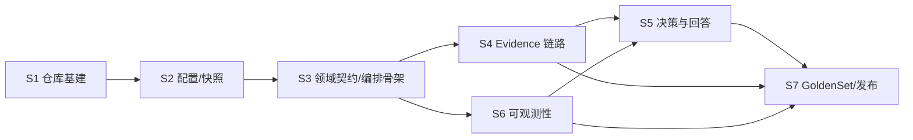

# Stage 划分与里程碑

## 1. Stage 总览

| Stage | 名称 | 关键交付 | 粗估人日 | 依赖 |
|---|---|---|---:|---|
| S1 | 仓库与工程基建 | 开源仓库、CI 门禁、Go 骨架、ADR | 4 | — |
| S2 | 配置与运行时快照 | schema/加载/校验、config_version、原子 Reload | 8 | S1 |
| S3 | 领域契约与编排骨架 | 公共类型、错误分类、deadline 引擎、编排骨架、事件总线 | 9 | S2 |
| S4 | Evidence 链路 | Provider 契约、有效期/权限过滤、安全缓存 | 12 | S3 |
| S5 | 决策与回答 | DecisionProvider、规则引擎、Jev adapter、降级链、引用校验 | 14 | S3；5.2~5.4 需 S4 |
| S6 | 可观测性 | Health、Prometheus collector、trace sink | 7 | S3（事件总线）；可与 S4/S5 并行 |
| S7 | GoldenSet 验收与发布 | 验收套件、安全审计、v1.2.0 发布 | 10 | S1~S6 全部 |

总计约 64 人日（单线程估算，不含评审往返）。2~3 人并行（S4 ∥ S6，随后 S5）时墙钟约 5~6 周。

## 2. 依赖图

并行建议：
- S4 与 S6 在 S3 完成后并行（S6 只依赖事件总线与组件接口）。
- Epic 5.1（契约+规则引擎）只依赖 S3，可与 S4 并行先行；5.2~5.4 依赖 S4 的 Evidence 类型与过滤结果。
- S7 的 7.1.1（用例 schema/样本构建）不依赖代码，可在 S4 期间并行启动。

## 3. 各 Stage 概述

### S1 仓库与工程基建
开源仓库从零到 CI 绿：仓库/许可/治理文件、docs 迁移、ADR 机制、Go module 骨架、lint/CI/覆盖率门禁。**出口：** main 分支保护生效、CI 全绿、空模块可 `go build ./...`、ADR-0001/0002 归档。

### S2 配置与运行时快照
docs/02 示例 YAML 完整可加载：类型系统、严格解析、预算等式与全部启动校验、脱敏 config_version、不可变 snapshot 与原子 Reload（失败保持旧值、在途请求持旧快照）。**出口：** F-001/F-011 由单测+并发测试证明。

### S3 领域契约与编排骨架
docs/03 全部公共 API 类型与哨兵错误；五阶段 deadline 引擎（root/阶段派生/cancel 语义/provider ctx 合规）；编排器骨架与内部事件总线（供 S6 消费）；Client 并发安全与 Close 语义。**出口：** F-002/F-012 单测+`-race` 证明；骨架可注入 fake provider 走通全流程。

### S4 Evidence 链路
EvidenceProvider 契约与参考实现/故障注入；有效期过滤（expired/future/unknown fail-closed/max-age 推导）；权限复核（含缓存命中后复核、补检重过滤）；问题规范化与安全 cache key；有界内存缓存全部策略。**出口：** F-003/F-004 单测+属性测试证明。

### S5 决策与回答
DecisionProvider 契约与响应校验（action 枚举/目标组归属/NaN 拒绝）；确定性规则引擎；Jev adapter（协议封装、单次尝试、版本捕获）；降级链（Jev→规则→受约束决策缓存→abstain/clarify）；回答组装与引用安全（citation∈最终 Evidence、max_citations、无 Evidence 禁答）。**出口：** F-007/F-008/F-010 证明。

### S6 可观测性
Health 聚合（not_ready/degraded/healthy，独立短超时）；全套 Prometheus 指标与 label allowlist/基数防护、宿主 Registerer 注入；TraceSink、include 白名单、脱敏规则、TraceID 透传。**出口：** F-005/F-006/F-009 证明；指标增量断言测试通过。

### S7 GoldenSet 验收与发布
用例 schema 与 ≥100 条去标识化样本、P0 子集冻结；runner 与评分器（Recall@k/Precision@k/MRR/nDCG/引用质量）；验收矩阵 19 类场景自动化；敏感数据与依赖审计；README/godoc/CHANGELOG/MIGRATION、v1.2.0 Release。**出口：** docs/01 §7 首发门禁全项通过并留档报告。

## 4. 里程碑

| 里程碑 | 内容 | 对应 |
|---|---|---|
| M1 | 仓库就绪、CI 绿 | S1 完成 |
| M2 | 配置链路可用（Load/Validate/Reload） | S2 完成 |
| M3 | 端到端骨架走通（fake provider，全阶段 deadline 正确） | S3 完成 |
| M4 | Evidence 链路 + 可观测可用 | S4、S6 完成 |
| M5 | 全功能可用（决策/回答/降级全链） | S5 完成 |
| M6 | v1.2.0 开源发布 | S7 完成 |
